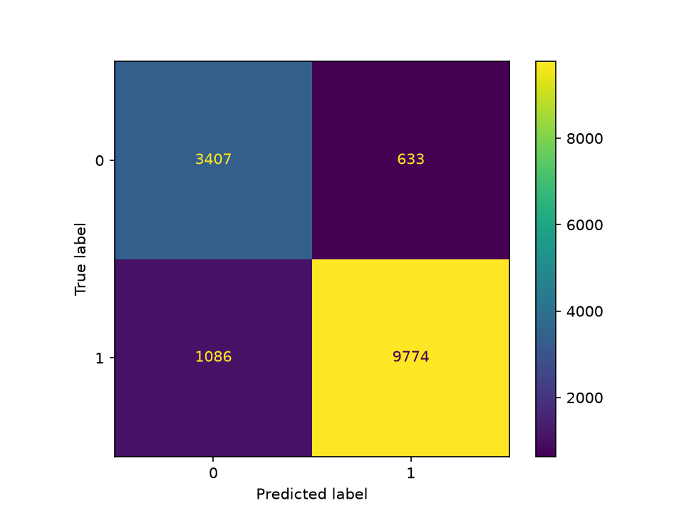
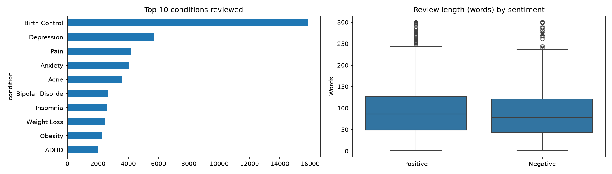
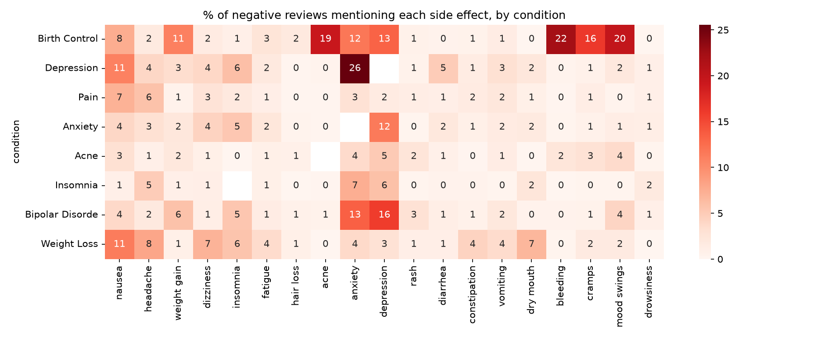

# Drug Review Sentiment Analysis (NLP)

## Project Overview

Can patient reviews help us understand whether people have positive or negative experiences with medications?

This project applies Natural Language Processing (NLP) and machine learning to patient drug reviews to classify sentiment and explore commonly mentioned side effects in negative reviews.

**Objective:** Build a binary sentiment classification model to identify positive and negative patient experiences.

**Tools:** Python, Pandas, Scikit-learn, TF-IDF, Logistic Regression, Naive Bayes, Matplotlib and Seaborn.

## Key Findings

- Logistic Regression achieved a **macro F1-score of 0.859**, outperforming the Multinomial Naive Bayes baseline of 0.667.
- The best Logistic Regression hyperparameter was **C = 16**, selected using 3-fold cross-validation.
- The final model achieved **88.5% accuracy** on the test dataset.
- Positive sentiment F1-score: 0.919.
- Negative sentiment F1-score: 0.799.
- Birth Control was the most frequently reviewed medical condition.
- Rating 10 was the most frequent rating in the original training data.

## Model Evaluation

| Metric | Result |
|---|---:|
| Naive Bayes macro F1 | 0.667 |
| Logistic Regression macro F1 | 0.859 |
| Test accuracy | 88.5% |
| Best Logistic Regression C | 16 |



## Exploratory Data Analysis

The analysis examined rating distributions, frequently reviewed medical conditions and patient review lengths.



## Side-Effect Mention Analysis

A keyword-based analysis was performed on negative reviews across the eight most-reviewed medical conditions.



These results represent keyword mentions in patient reviews, not medically confirmed adverse drug reactions.

## Methodology

1. Loaded the UCI Drug Review Dataset.
2. Cleaned review text and removed duplicate reviews.
3. Converted ratings into binary sentiment labels:
   - Ratings 1–4: Negative
   - Ratings 7–10: Positive
   - Ratings 5–6: Excluded
4. Converted review text into TF-IDF features using single words and word pairs.
5. Trained a Multinomial Naive Bayes baseline model.
6. Trained and tuned Logistic Regression using GridSearchCV with 3-fold cross-validation.
7. Evaluated the model using accuracy, precision, recall, F1-score and a confusion matrix.
8. Examined model coefficients and misclassified reviews.
9. Explored side-effect keyword mentions in negative reviews.

## Dataset

Source: [UCI Drug Review Dataset (Drugs.com)](https://archive.ics.uci.edu/ml/machine-learning-databases/00462/drugsCom_raw.zip)

The dataset contains patient reviews, drug names, medical conditions, ratings, review dates and usefulness votes.

Raw dataset files are not included in this repository.

## How to Run

Install the required packages:

```bash
pip install -r requirements.txt
```

Download and extract the dataset into the `data/` folder.

Required files:
- `drugsComTrain_raw.tsv`
- `drugsComTest_raw.tsv`

Open and run `analysis.ipynb` from top to bottom.

## Limitations

- Star ratings are an imperfect substitute for actual patient sentiment.
- Positive reviews are more common than negative reviews.
- TF-IDF models may struggle with sarcasm, mixed opinions and context.
- Keyword matching may miss synonyms, spelling variations and negation.
- Online reviews may not represent the wider patient population.
- Review mentions do not establish that a medication caused a side effect.

---

**Govind Bansal** · B.Pharm, BITS Pilani · [GitHub](https://github.com/govindbansal-pixel)